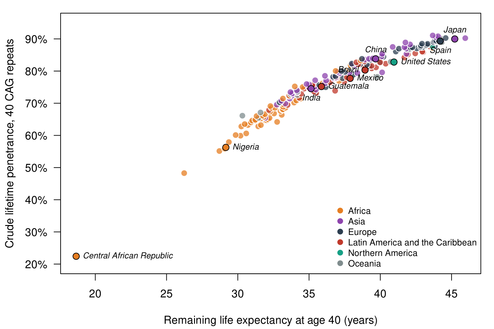
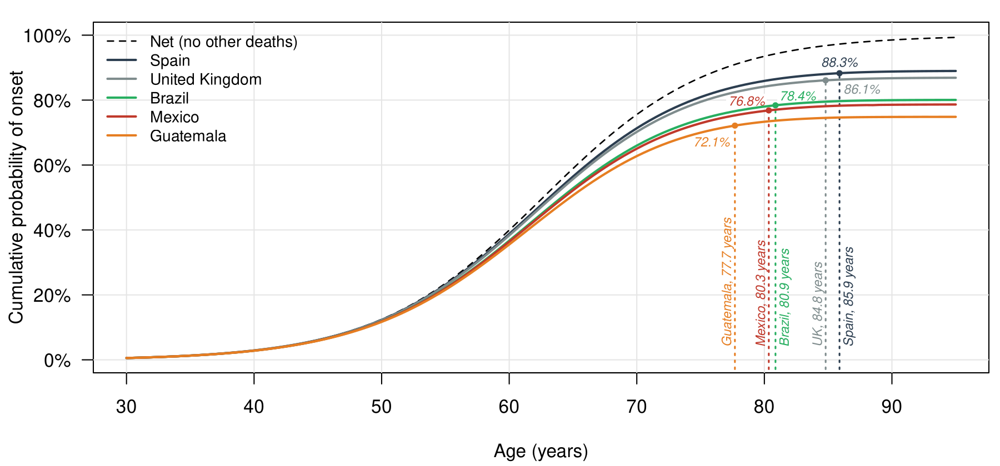

Fully penetrant within whose lifetime? Step-by-step calculations
================
J. E. Vazquez
October 22, 2026

- [Data](#data)
- [Step 1: distribution of age at
  onset](#step-1-distribution-of-age-at-onset)
- [Step 2: net penetrance among carriers alive at age
  18](#step-2-net-penetrance-among-carriers-alive-at-age-18)
- [Step 3: background mortality as a piecewise-constant
  hazard](#step-3-background-mortality-as-a-piecewise-constant-hazard)
- [Step 4: survival from age 18](#step-4-survival-from-age-18)
- [Step 5: crude penetrance](#step-5-crude-penetrance)
- [Step 6: median age at death and the labeled points in Figure
  1](#step-6-median-age-at-death-and-the-labeled-points-in-figure-1)
- [Table 1: net and crude penetrance by repeat length and
  country](#table-1-net-and-crude-penetrance-by-repeat-length-and-country)
- [Sensitivity analyses (Supplementary Table
  S1)](#sensitivity-analyses-supplementary-table-s1)
- [Global supplementary analysis (Supplementary Figure
  S1)](#global-supplementary-analysis-supplementary-figure-s1)
- [Figure 1](#figure-1)
- [Session information](#session-information)

This document reproduces the calculations behind the paper *Fully
Penetrant Within Whose Lifetime? Background Mortality and the Penetrance
of Huntington’s Disease Alleles*. Each section follows one step of
Supplementary Methods S1, uses carriers of 40 CAG repeats in Mexico as
the worked example, and checks the result against the outputs of the
analysis scripts in `code/`. All code is base R; `knitr` is used only to
print tables.

# Data

The main analysis uses the 2019 World Health Organization (WHO) life
tables for both sexes: age-specific death rates ${}_n m_x$ (indicator
`LIFE_0000000029`) and life expectancies $e_x$ (indicator
`LIFE_0000000035`) for 14 countries. ${}_n m_x$ is the death rate in the
age group that starts at age $x$ and spans $n$ years.

``` r
lt <- read.csv("code/data/who_life_tables.csv", stringsAsFactors = FALSE)
lt <- lt[order(lt$country, lt$year, lt$age_start), ]
table(lt$country, lt$year)
```

         
          2019 2023
      ARG   19    0
      BRA   19    0
      CAN   19    0
      CHL   19    0
      COL   19    0
      ESP   19   19
      GBR   19   19
      GTM   19    0
      HND   19    0
      MEX   19   19
      PER   19    0
      SLV   19    0
      SWE   19    0
      USA   19    0

``` r
knitr::kable(lt[lt$country == "MEX" & lt$year == 2019, ], row.names = FALSE,
             caption = "WHO 2019 life table for Mexico, both sexes")
```

| country | year | age_group | age_start |      nmx |       ex |
|:--------|-----:|:----------|----------:|---------:|---------:|
| MEX     | 2019 | 00-01     |         0 | 0.013837 | 75.01791 |
| MEX     | 2019 | 01-04     |         1 | 0.000316 | 75.05598 |
| MEX     | 2019 | 05-09     |         5 | 0.000251 | 71.14889 |
| MEX     | 2019 | 10-14     |        10 | 0.000300 | 66.23519 |
| MEX     | 2019 | 15-19     |        15 | 0.000799 | 61.33093 |
| MEX     | 2019 | 20-24     |        20 | 0.001375 | 56.56654 |
| MEX     | 2019 | 25-29     |        25 | 0.001689 | 51.93950 |
| MEX     | 2019 | 30-34     |        30 | 0.001907 | 47.35879 |
| MEX     | 2019 | 35-39     |        35 | 0.002350 | 42.78853 |
| MEX     | 2019 | 40-44     |        40 | 0.003110 | 38.26477 |
| MEX     | 2019 | 45-49     |        45 | 0.004276 | 33.82521 |
| MEX     | 2019 | 50-54     |        50 | 0.005925 | 29.50218 |
| MEX     | 2019 | 55-59     |        55 | 0.008813 | 25.31414 |
| MEX     | 2019 | 60-64     |        60 | 0.013243 | 21.34212 |
| MEX     | 2019 | 65-69     |        65 | 0.019007 | 17.63246 |
| MEX     | 2019 | 70-74     |        70 | 0.028214 | 14.14230 |
| MEX     | 2019 | 75-79     |        75 | 0.043411 | 10.90930 |
| MEX     | 2019 | 80-84     |        80 | 0.071874 |  7.95678 |
| MEX     | 2019 | 85PLUS    |        85 | 0.173063 |  5.34734 |

WHO 2019 life table for Mexico, both sexes

# Step 1: distribution of age at onset

Following Langbehn et al. (2004), age at onset $T$ for a carrier of $c$
CAG repeats follows a logistic distribution with mean
$\mu_c = 21.54 + \exp(9.556 - 0.1460c)$ and variance
$\sigma_c^2 = 35.55 + \exp(17.72 - 0.3269c)$. The logistic scale
parameter is $s_c = \sigma_c\sqrt{3}/\pi$.

``` r
langbehn <- function(cag, sd_scale = 1) {
  mu <- 21.54 + exp(9.556 - 0.1460 * cag)
  sigma <- sqrt(35.55 + exp(17.72 - 0.3269 * cag)) * sd_scale
  s <- sigma * sqrt(3) / pi
  list(mu = mu, sigma = sigma, s = s,
       cdf = function(t) plogis(t, location = mu, scale = s),
       pdf = function(t) dlogis(t, location = mu, scale = s))
}
m40 <- langbehn(40)
c(mu = m40$mu, sigma = m40$sigma, scale = m40$s)
```

          mu    sigma    scale 
    62.63967 11.81141  6.51197 

# Step 2: net penetrance among carriers alive at age 18

Net penetrance is the conditional probability of onset by age $t$ given
no onset by $a_0 = 18$:
$$N_c(t) = P(T \le t \mid T > a_0) = \frac{F_c(t) - F_c(a_0)}{1 - F_c(a_0)},$$
and its derivative, $g_c(t) = f_c(t)/[1 - F_c(a_0)]$, is the density of
onset age among those carriers.

``` r
a0 <- 18
net_pen <- function(cag, t, a0 = 18, sd_scale = 1) {
  m <- langbehn(cag, sd_scale)
  (m$cdf(t) - m$cdf(a0)) / (1 - m$cdf(a0))
}
c(F40_at_18 = m40$cdf(18), net_by_65 = net_pen(40, 65), net_by_75 = net_pen(40, 75),
  net_by_85 = net_pen(40, 85))
```

     F40_at_18  net_by_65  net_by_75  net_by_85 
    0.00105304 0.58920340 0.86953830 0.96870920 

``` r
## The conditional density integrates to 1 over [18, infinity)
integrate(function(t) m40$pdf(t) / (1 - m40$cdf(a0)), a0, Inf)$value
```

    [1] 1

# Step 3: background mortality as a piecewise-constant hazard

Each WHO rate is treated as a constant hazard within its age group, and
the rate for ages 85 and older applies from 85 onward:
$h_k(t) = {}_n m_x$ for $x \le t < x + n$.

``` r
breaks <- c(0, 1, seq(5, 85, 5))
make_hazard <- function(cc, yr = 2019, open = "nmx") {
  d <- lt[lt$country == cc & lt$year == yr, ]
  h <- d$nmx
  if (open == "inv_e85") h[length(h)] <- 1 / d$ex[nrow(d)]
  function(t) h[findInterval(t, breaks)]
}
h_mex <- make_hazard("MEX")
c(age_22 = h_mex(22), age_62 = h_mex(62), age_82 = h_mex(82))
```

       age_22    age_62    age_82 
    0.0013749 0.0132428 0.0718740 

# Step 4: survival from age 18

$$S_k(t \mid a_0) = \exp\{-\int_{a_0}^{t} h_k(v)\,dv\} = \exp\{-\sum_j h_{kj}\,\Delta_j(t)\},$$
where $\Delta_j(t)$ is the number of years of age group $j$ between
$a_0$ and $t$. The sum is exact for a piecewise-constant hazard.

``` r
make_surv <- function(haz) {
  function(t, a0) {
    sapply(t, function(tt) {
      if (tt <= a0) return(1)
      knots <- sort(unique(c(a0, breaks[breaks > a0 & breaks < tt], tt)))
      exp(-sum(haz(knots[-length(knots)]) * diff(knots)))
    })
  }
}
S_mex <- make_surv(h_mex)
S_esp <- make_surv(make_hazard("ESP"))
```

The table below writes out the sum for Mexico term by term
(Supplementary Table S2).

``` r
d <- lt[lt$country == "MEX" & lt$year == 2019 & lt$age_start >= 15 & lt$age_start < 80, ]
years_after_18 <- pmin(d$age_start + 5, 80) - pmax(d$age_start, 18)
contribution <- d$nmx * years_after_18
H <- cumsum(contribution)
tabS2 <- data.frame(age_group = d$age_group, years_after_18, nmx = d$nmx,
                    contribution, cumulative_hazard = H, to_age = d$age_start + 5,
                    survival_pct = 100 * exp(-H))
knitr::kable(tabS2, digits = c(0, 0, 6, 6, 6, 0, 1), row.names = FALSE,
             caption = "Survival from age 18 in Mexico, 2019, computed term by term")
```

| age_group | years_after_18 |      nmx | contribution | cumulative_hazard | to_age | survival_pct |
|:----------|---------------:|---------:|-------------:|------------------:|-------:|-------------:|
| 15-19     |              2 | 0.000799 |     0.001599 |          0.001599 |     20 |         99.8 |
| 20-24     |              5 | 0.001375 |     0.006875 |          0.008473 |     25 |         99.2 |
| 25-29     |              5 | 0.001689 |     0.008445 |          0.016918 |     30 |         98.3 |
| 30-34     |              5 | 0.001907 |     0.009534 |          0.026453 |     35 |         97.4 |
| 35-39     |              5 | 0.002350 |     0.011751 |          0.038204 |     40 |         96.3 |
| 40-44     |              5 | 0.003110 |     0.015548 |          0.053752 |     45 |         94.8 |
| 45-49     |              5 | 0.004276 |     0.021380 |          0.075132 |     50 |         92.8 |
| 50-54     |              5 | 0.005925 |     0.029625 |          0.104757 |     55 |         90.1 |
| 55-59     |              5 | 0.008813 |     0.044066 |          0.148823 |     60 |         86.2 |
| 60-64     |              5 | 0.013243 |     0.066214 |          0.215037 |     65 |         80.7 |
| 65-69     |              5 | 0.019007 |     0.095034 |          0.310071 |     70 |         73.3 |
| 70-74     |              5 | 0.028214 |     0.141069 |          0.451140 |     75 |         63.7 |
| 75-79     |              5 | 0.043411 |     0.217055 |          0.668195 |     80 |         51.3 |

Survival from age 18 in Mexico, 2019, computed term by term

For example, from 18 to 60 the interval covers 2 years of $[15, 20)$ and
5 years of each group from $[20, 25)$ to $[55, 60)$:

``` r
H60 <- 2 * d$nmx[d$age_start == 15] + 5 * sum(d$nmx[d$age_start >= 20 & d$age_start <= 55])
H80 <- H60 + 5 * sum(d$nmx[d$age_start >= 60 & d$age_start <= 75])
c(H60 = H60, S60 = exp(-H60), S60_function = S_mex(60, 18),
  H80 = H80, S80 = exp(-H80), S80_function = S_mex(80, 18))
```

             H60          S60 S60_function          H80          S80 S80_function 
        0.148823     0.861721     0.861721     0.668195     0.512633     0.512633 

``` r
c(Spain_S60 = S_esp(60, 18), Spain_S80 = S_esp(80, 18))
```

    Spain_S60 Spain_S80 
     0.946702  0.712905 

# Step 5: crude penetrance

Let $D$ be age at death from other causes. Assuming $T$ and $D$ are
independent, conditioning on onset at age $u$ gives
$P(D > u \mid D > a_0) = S_k(u \mid a_0)$, so
$$C_{ck}(t) = \int_{a_0}^{t} S_k(u \mid a_0)\, g_c(u)\, du = \frac{1}{1 - F_c(a_0)} \int_{a_0}^{t} f_c(u)\, S_k(u \mid a_0)\, du.$$
Crude lifetime penetrance is $C_{ck}(\infty)$, computed with an upper
limit of 130 years.

``` r
crude_pen <- function(cag, cc, a0 = 18, yr = 2019, open = "nmx", sd_scale = 1, upper = 130) {
  m <- langbehn(cag, sd_scale)
  S <- make_surv(make_hazard(cc, yr, open))
  integrate(function(u) m$pdf(u) * S(u, a0), a0, upper, subdivisions = 2000)$value /
    (1 - m$cdf(a0))
}
c(Mexico = crude_pen(40, "MEX"), Spain = crude_pen(40, "ESP"),
  gap_points = 100 * (crude_pen(40, "ESP") - crude_pen(40, "MEX")))
```

        Mexico      Spain gap_points 
      0.786720   0.890364  10.364342 

Setting $S_k = 1$ recovers net penetrance, so crude penetrance can never
exceed net penetrance:

``` r
no_death <- integrate(function(u) m40$pdf(u), a0, 130)$value / (1 - m40$cdf(a0))
c(crude_without_death = no_death, net_by_130 = net_pen(40, 130))
```

    crude_without_death          net_by_130 
               0.999968            0.999968 

As a numerical check, a Riemann sum on a grid of 0.001 years gives the
same answer:

``` r
grid_crude <- function(k, cc, a0 = 18, dt = 0.001) {
  m <- langbehn(k); h <- make_hazard(cc)
  u <- seq(a0, 130, by = dt)
  S <- exp(-cumsum(c(0, h(u[-length(u)]) * dt)))
  sum(m$pdf(u) * S) * dt / (1 - m$cdf(a0))
}
100 * c(Mexico = grid_crude(40, "MEX") - crude_pen(40, "MEX"),
        Spain = grid_crude(40, "ESP") - crude_pen(40, "ESP"))
```

         Mexico       Spain 
    -0.00301198 -0.00206903 

# Step 6: median age at death and the labeled points in Figure 1

``` r
med_death <- function(cc) uniroot(function(t) make_surv(make_hazard(cc))(t, 18) - 0.5,
                                  c(19, 129))$root
dot <- function(cc) {
  m <- med_death(cc); S <- make_surv(make_hazard(cc))
  integrate(function(u) m40$pdf(u) * S(u, 18), 18, m)$value / (1 - m40$cdf(18))
}
fig_cc <- c("ESP", "GBR", "BRA", "MEX", "GTM")
knitr::kable(data.frame(country = fig_cc,
                        median_age_at_death = sapply(fig_cc, med_death),
                        crude_by_median_pct = 100 * sapply(fig_cc, dot)),
             digits = 1, row.names = FALSE)
```

| country | median_age_at_death | crude_by_median_pct |
|:--------|--------------------:|--------------------:|
| ESP     |                85.9 |                88.3 |
| GBR     |                84.8 |                86.1 |
| BRA     |                80.9 |                78.4 |
| MEX     |                80.3 |                76.8 |
| GTM     |                77.7 |                72.1 |

# Table 1: net and crude penetrance by repeat length and country

``` r
countries <- c("ESP", "SWE", "GBR", "CAN", "USA", "CHL", "PER", "COL", "ARG", "BRA",
               "MEX", "SLV", "HND", "GTM")
cags <- 40:45
tab1 <- t(sapply(cags, function(k) sapply(countries, function(cc) crude_pen(k, cc))))
rownames(tab1) <- cags
knitr::kable(100 * t(tab1), digits = 1,
             caption = "Crude lifetime penetrance (%) by country (rows) and CAG repeat length (columns)")
```

|     |   40 |   41 |   42 |   43 |   44 |   45 |
|:----|-----:|-----:|-----:|-----:|-----:|-----:|
| ESP | 89.0 | 93.7 | 96.2 | 97.6 | 98.4 | 98.8 |
| SWE | 89.1 | 93.8 | 96.2 | 97.5 | 98.1 | 98.6 |
| GBR | 86.9 | 92.1 | 95.0 | 96.6 | 97.6 | 98.2 |
| CAN | 87.6 | 92.5 | 95.1 | 96.6 | 97.5 | 98.1 |
| USA | 83.0 | 88.9 | 92.4 | 94.5 | 95.9 | 96.8 |
| CHL | 86.3 | 91.6 | 94.5 | 96.2 | 97.2 | 97.8 |
| PER | 84.1 | 89.6 | 92.9 | 94.8 | 96.0 | 96.8 |
| COL | 84.6 | 90.1 | 93.1 | 94.8 | 95.9 | 96.6 |
| ARG | 81.6 | 88.4 | 92.4 | 94.7 | 96.1 | 97.0 |
| BRA | 80.1 | 86.7 | 90.6 | 93.1 | 94.6 | 95.7 |
| MEX | 78.7 | 85.5 | 89.8 | 92.5 | 94.2 | 95.4 |
| SLV | 75.8 | 82.7 | 87.1 | 90.1 | 92.2 | 93.7 |
| HND | 75.4 | 83.3 | 88.3 | 91.5 | 93.5 | 94.8 |
| GTM | 74.9 | 82.6 | 87.5 | 90.7 | 92.8 | 94.3 |

Crude lifetime penetrance (%) by country (rows) and CAG repeat length
(columns)

``` r
knitr::kable(data.frame(cag = cags, median_onset = sapply(cags, function(k) langbehn(k)$mu),
                        net_by_75_pct = 100 * sapply(cags, function(k) net_pen(k, 75))),
             digits = 1, row.names = FALSE, caption = "Onset model by repeat length")
```

| cag | median_onset | net_by_75_pct |
|----:|-------------:|--------------:|
|  40 |         62.6 |          87.0 |
|  41 |         57.1 |          95.7 |
|  42 |         52.2 |          98.7 |
|  43 |         48.1 |          99.7 |
|  44 |         44.5 |          99.9 |
|  45 |         41.3 |         100.0 |

Onset model by repeat length

Check against the script output (`code/output/table1.csv`):

``` r
saved <- read.csv("code/output/table1.csv")
max(abs(as.matrix(saved[, countries]) - tab1))
```

    [1] 5.55112e-16

Crude penetrance at 40 repeats against remaining life expectancy at age
40:

``` r
e40 <- sapply(countries, function(cc) lt$ex[lt$country == cc & lt$year == 2019 & lt$age_start == 40])
knitr::kable(data.frame(country = countries, e40 = e40, crude40_pct = 100 * tab1["40", ])[order(e40), ],
             digits = 1, row.names = FALSE)
```

| country |  e40 | crude40_pct |
|:--------|-----:|------------:|
| GTM     | 35.7 |        74.9 |
| HND     | 35.9 |        75.4 |
| SLV     | 37.3 |        75.8 |
| MEX     | 38.3 |        78.7 |
| BRA     | 38.8 |        80.1 |
| ARG     | 39.1 |        81.6 |
| USA     | 40.7 |        83.0 |
| COL     | 40.8 |        84.6 |
| PER     | 41.6 |        84.1 |
| GBR     | 42.3 |        86.9 |
| CHL     | 42.9 |        86.3 |
| CAN     | 43.4 |        87.6 |
| SWE     | 43.5 |        89.1 |
| ESP     | 43.9 |        89.0 |

# Sensitivity analyses (Supplementary Table S1)

``` r
sens <- function(f) sapply(c("MEX", "ESP", "GBR"), function(cc) f(40, cc))
S1 <- rbind(
  main               = sens(function(k, cc) crude_pen(k, cc)),
  hazard_85_inv_e85  = sens(function(k, cc) crude_pen(k, cc, open = "inv_e85")),
  life_tables_2023   = sens(function(k, cc) crude_pen(k, cc, yr = 2023)),
  start_age_30       = sens(function(k, cc) crude_pen(k, cc, a0 = 30)),
  onset_sd_x0.8      = sens(function(k, cc) crude_pen(k, cc, sd_scale = 0.8)),
  onset_sd_x1.2      = sens(function(k, cc) crude_pen(k, cc, sd_scale = 1.2)))
S1 <- cbind(100 * S1, gap_ESP_MEX_points = 100 * (S1[, "ESP"] - S1[, "MEX"]))
knitr::kable(S1, digits = 1, caption = "Crude lifetime penetrance (%) at 40 repeats")
```

|                   |  MEX |  ESP |  GBR | gap_ESP_MEX_points |
|:------------------|-----:|-----:|-----:|-------------------:|
| main              | 78.7 | 89.0 | 86.9 |               10.4 |
| hazard_85_inv_e85 | 78.7 | 89.0 | 86.9 |               10.3 |
| life_tables_2023  | 79.0 | 89.3 | 86.3 |               10.3 |
| start_age_30      | 79.9 | 89.3 | 87.3 |                9.4 |
| onset_sd_x0.8     | 80.2 | 90.6 | 88.6 |               10.3 |
| onset_sd_x1.2     | 77.0 | 87.3 | 85.1 |               10.3 |

Crude lifetime penetrance (%) at 40 repeats

# Global supplementary analysis (Supplementary Figure S1)

The global analysis repeats Step 5 for 201 countries with single-year
death rates from the United Nations World Population Prospects 2024
(`code/extract_wpp2024.R`, `code/global_penetrance.R`). The results are
read from the saved output here because the full run takes a few seconds
per country.

``` r
g <- read.csv("code/output/global_penetrance.csv")
nrow(g)
```

    [1] 201

``` r
summary(100 * g$crude40)
```

       Min. 1st Qu.  Median    Mean 3rd Qu.    Max. 
       22.4    70.3    77.8    76.7    83.9    91.1 

``` r
g$rank <- rank(g$crude40)
knitr::kable(g[g$name %in% c("Mexico", "Guatemala", "Spain", "Sweden", "Canada", "Japan",
                              "China", "India", "United States of America"),
               c("name", "e40", "crude40", "rank")],
             digits = 3, row.names = FALSE)
```

| name                     |    e40 | crude40 | rank |
|:-------------------------|-------:|--------:|-----:|
| India                    | 35.142 |   0.745 |   77 |
| Guatemala                | 35.869 |   0.752 |   85 |
| Mexico                   | 37.885 |   0.777 |  100 |
| United States of America | 40.959 |   0.828 |  142 |
| China                    | 39.671 |   0.838 |  150 |
| Canada                   | 43.651 |   0.877 |  177 |
| Spain                    | 44.209 |   0.893 |  188 |
| Sweden                   | 43.921 |   0.895 |  191 |
| Japan                    | 45.225 |   0.900 |  194 |

``` r
knitr::kable(read.csv("code/output/global_vs_who.csv"), digits = 3,
             caption = "Crude penetrance at 40 repeats: UN WPP 2024 against WHO, 14 main countries")
```

| iso3 |   wpp |   who | diff_pts |
|:-----|------:|------:|---------:|
| ESP  | 0.893 | 0.890 |    0.279 |
| SWE  | 0.895 | 0.891 |    0.353 |
| GBR  | 0.870 | 0.869 |    0.118 |
| CAN  | 0.877 | 0.876 |    0.125 |
| USA  | 0.828 | 0.830 |   -0.172 |
| CHL  | 0.852 | 0.863 |   -1.169 |
| PER  | 0.808 | 0.841 |   -3.213 |
| COL  | 0.827 | 0.846 |   -1.870 |
| ARG  | 0.814 | 0.816 |   -0.192 |
| BRA  | 0.803 | 0.801 |    0.228 |
| MEX  | 0.777 | 0.787 |   -0.944 |
| SLV  | 0.732 | 0.758 |   -2.605 |
| HND  | 0.756 | 0.754 |    0.229 |
| GTM  | 0.752 | 0.749 |    0.339 |

Crude penetrance at 40 repeats: UN WPP 2024 against WHO, 14 main
countries



# Figure 1



# Session information

``` r
sessionInfo()
```

    R version 4.3.3 (2024-02-29)
    Platform: x86_64-pc-linux-gnu (64-bit)
    Running under: Ubuntu 24.04.5 LTS

    Matrix products: default
    BLAS:   /usr/lib/x86_64-linux-gnu/blas/libblas.so.3.12.0 
    LAPACK: /usr/lib/x86_64-linux-gnu/lapack/liblapack.so.3.12.0

    locale:
    [1] C

    time zone: Etc/UTC
    tzcode source: system (glibc)

    attached base packages:
    [1] stats     graphics  grDevices utils     datasets  methods   base     

    loaded via a namespace (and not attached):
     [1] compiler_4.3.3  fastmap_1.1.1   cli_3.6.2       tools_4.3.3    
     [5] htmltools_0.5.7 yaml_2.3.8      rmarkdown_2.25  highr_0.10     
     [9] knitr_1.45      xfun_0.41       digest_0.6.34   rlang_1.1.3    
    [13] evaluate_0.23  
